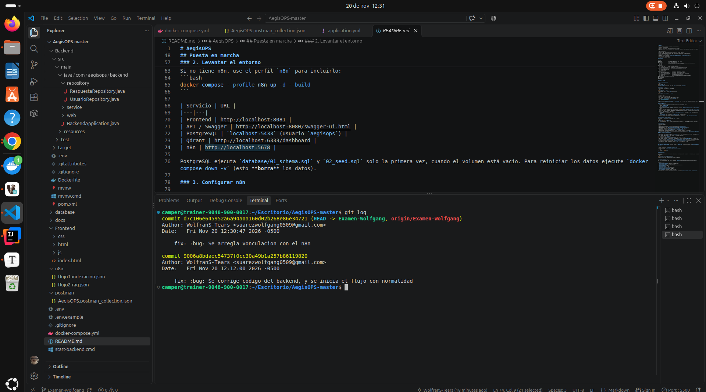

# AegisOPS

Plataforma web de gestión de incidentes tecnológicos que:
- centraliza los incidentes;
- analiza el histórico con indicadores verificables en SQL;
- sugiere soluciones con **búsqueda semántica (embeddings + Qdrant)** y un **asistente RAG** que solo responde con artículos verificados de la base de conocimiento.

| Capa | Tecnología |
|---|---|
| Frontend | HTML, CSS y JavaScript vanilla (Tailwind por CDN, Chart.js) |
| Backend | Java 21 · Spring Boot 4.1 (Web MVC, Data JPA, Validation, springdoc-openapi) |
| Base de datos | PostgreSQL 17 |
| Orquestación IA | n8n (2 flujos) |
| Embeddings y LLM | OpenRouter (`openai/text-embedding-3-small`, `openai/gpt-4o-mini`) |
| Base vectorial | Qdrant 1.15 |
| Infraestructura | Docker Compose |

## Estructura

```
AegisOPS/
├── Backend/                 Spring Boot (Dockerfile, mvnw, src/)
├── Frontend/                HTML, CSS y JS vanilla
│   ├── html/                index, login, dashboard, incidentes, asistente, historial, conocimiento
│   ├── js/                  api.js, layout.js y un script por pantalla
│   └── css/
├── database/
│   ├── 01_schema.sql        Esquema: tablas, FK, CHECK, índices
│   ├── 02_seed.sql          Datos iniciales (generados)
│   ├── consultas_analiticas.sql   SQL de todos los indicadores y verificaciones
│   └── generador/generar_datos.py Generador determinista de datos sintéticos
├── n8n/
│   ├── flujo1-indexacion.json
│   └── flujo2-rag.json
├── docs/
│   ├── arquitectura.md               Diagramas de componentes y secuencia
│   ├── modelo-entidad-relacion.md    Diagrama E-R, restricciones e índices
│   ├── informe-analisis-datos.md     Indicadores, SQL, interpretación y conclusiones
│   ├── pruebas-funcionales.md        Las 10 pruebas obligatorias
│   ├── presentacion.md               Guion de la presentación final
│   └── openapi.json                  Especificación OpenAPI exportada (evidencia Swagger)
├── postman/AegisOPS.postman_collection.json
├── docker-compose.yml
├── .env.example
└── AI_USAGE.md
```

## Puesta en marcha

### 1. Variables de entorno

```bash
cp .env.example .env
```
Edite `DB_PASSWORD` como mínimo. **No suba `.env`** (ya está en `.gitignore`).

### 2. Levantar el entorno

Si ya tiene n8n corriendo en el puerto 5678:
```bash
docker compose up -d --build
```
Si no tiene n8n, use el perfil `n8n` para incluirlo:
```bash
docker compose --profile n8n up -d --build
```

| Servicio | URL |
|---|---|
| Frontend | http://localhost:8081 |
| API / Swagger | http://localhost:8080/swagger-ui.html |
| PostgreSQL | `localhost:5433` (usuario `aegisops`) |
| Qdrant | http://localhost:6333/dashboard |
| n8n | http://localhost:5678 |

PostgreSQL ejecuta `database/01_schema.sql` y `02_seed.sql` solo la primera vez, cuando el volumen está vacío. Para reiniciar los datos ejecute `docker compose down -v` (esto **borra** los datos).

### 3. Configurar n8n

1. **Crear la credencial de OpenRouter.** En *Credentials → New → Header Auth*:
   - Nombre: `OpenRouter API`
   - Name: `Authorization`
   - Value: `Bearer <su OPENROUTER_API_KEY>`
2. **Importar los flujos.** Use *Workflows → Import from file* con `n8n/flujo1-indexacion.json` y `n8n/flujo2-rag.json`. También puede usar la CLI:
   ```bash
   docker cp n8n/flujo1-indexacion.json n8n:/tmp/f1.json && docker exec n8n n8n import:workflow --input=/tmp/f1.json
   ```
3. En cada nodo HTTP de OpenRouter (*Embeddings*, *Embedding pregunta*, *Generar respuesta*) seleccione la credencial `OpenRouter API`.
4. Revise el nodo **Config** de cada flujo:
   - URL de Qdrant y del backend. Por defecto es `host.docker.internal`; con el perfil `n8n` de Compose sirven `http://qdrant:6333` y `http://backend:8080`.
   - Modelos.
   - `internalToken`: debe ser igual a `INTERNAL_API_TOKEN` si lo configuró.
5. **Active** ambos flujos con el interruptor *Active*.
6. Indexe la base de conocimiento: **Conocimiento → Reindexar embeddings**, o `POST /api/articulos/indexar`.

### 4. Backend sin Docker (opcional)

Requiere JDK 21. Exporte las variables de `.env` y ejecute:
```bash
cd Backend && ./mvnw spring-boot:run
```
Para servir el frontend, use un servidor estático como Live Server en el puerto 5500, que ya está permitido en CORS.

## Funcionalidades

| Requisito | Dónde |
|---|---|
| RF01 Gestión de incidentes | Pantalla **Incidentes** · `/api/incidentes` |
| RF02 Base de conocimiento | Pantalla **Conocimiento** · `/api/articulos` |
| RF03 Embeddings en n8n | `n8n/flujo1-indexacion.json` · `/api/articulos/indexar` |
| RF04 Búsqueda semántica | Flujo 2: Qdrant `score_threshold` + `topK` (3 a 5) |
| RF05 Asistente RAG | Pantalla **Asistente RAG** · `/api/asistente/consultas` |
| RF06 Análisis de datos | `AnaliticaRepository` · `/api/analitica/*` |
| RF07 Dashboard | Pantalla **Dashboard** con filtros por fechas, categoría y prioridad |
| RF08 Historial y calificación | Pantallas **Asistente** e **Historial IA** · `PUT /api/asistente/respuestas/{id}/calificacion` |

### Reglas de negocio implementadas

- **El frontend solo consume Spring Boot.** `N8nClient` es el único punto de contacto con n8n. Los endpoints `/api/internal/**` que usa n8n pueden protegerse con `X-Internal-Token`.
- **Las fuentes deben existir y estar activas.** Se valida tres veces:
  1. Qdrant filtra por `indexable`.
  2. n8n consulta `/api/internal/articulos/fuentes`, que lee de PostgreSQL.
  3. El backend vuelve a validar antes de guardar.
- **Sin fuentes relevantes no hay solución inventada:** la consulta queda `SIN_RESULTADOS` con un mensaje fijo.
- Estados de consulta: `PENDIENTE`, `RESPONDIDA`, `SIN_RESULTADOS`, `ERROR`. Un fallo de n8n, OpenRouter o Qdrant deja la consulta en `ERROR` con su mensaje.
- El dashboard solo muestra resultados SQL. `database/consultas_analiticas.sql` permite verificarlos.
- Las credenciales van por variables de entorno (`.env`) y por credenciales de n8n.

### Umbral de similitud

`RAG_SIMILARITY_THRESHOLD=0.50` (similitud coseno) y `RAG_TOP_K=5`. La justificación está en `docs/informe-analisis-datos.md` §6.

## Pruebas

- Pruebas funcionales: `docs/pruebas-funcionales.md`.
- Colección Postman: `postman/AegisOPS.postman_collection.json`.
- Pruebas unitarias:
  ```bash
  cd Backend && ./mvnw test
  ```

## Datos iniciales

8 categorías, 12 usuarios, 30 artículos (26 activos y verificados) y 300 incidentes en 26 semanas, con fechas de resolución coherentes. Para regenerarlos:
```bash
python database/generador/generar_datos.py
```
La semilla es fija, así que el resultado siempre es idéntico.

## Flujo de trabajo con Git

Cada tarea va en su propia rama, que se crea desde `develop` y se integra mediante pull request. Ejemplos:

| Rama | Contenido |
|---|---|
| `feature/backend-skeleton` | Proyecto Spring Boot base |
| `feature/docker-compose` | Infraestructura |
| `feature/modelo-datos` | Esquema SQL, entidades y datos iniciales |
| `feature/incidentes` | RF01 |
| `feature/conocimiento` | RF02 |
| `feature/n8n-flujos` | RF03, RF04, RF05 |
| `feature/analitica-dashboard` | RF06, RF07 |
| `feature/historial-calificacion` | RF08 |
| `docs/entregables` | Informe, pruebas, diagramas |

Mensajes de commit en formato *Conventional Commits*, por ejemplo `feat(incidentes): filtro por responsable`.

