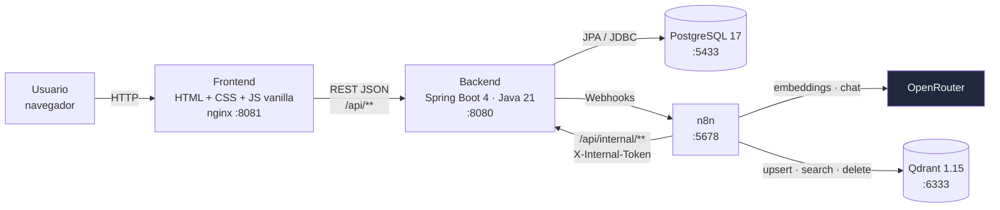
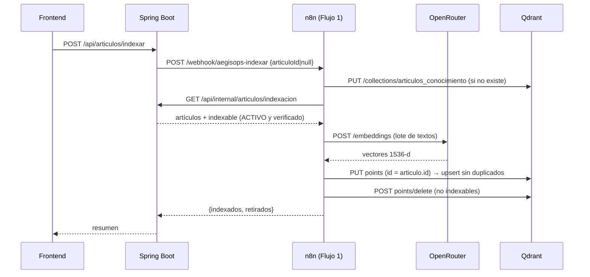
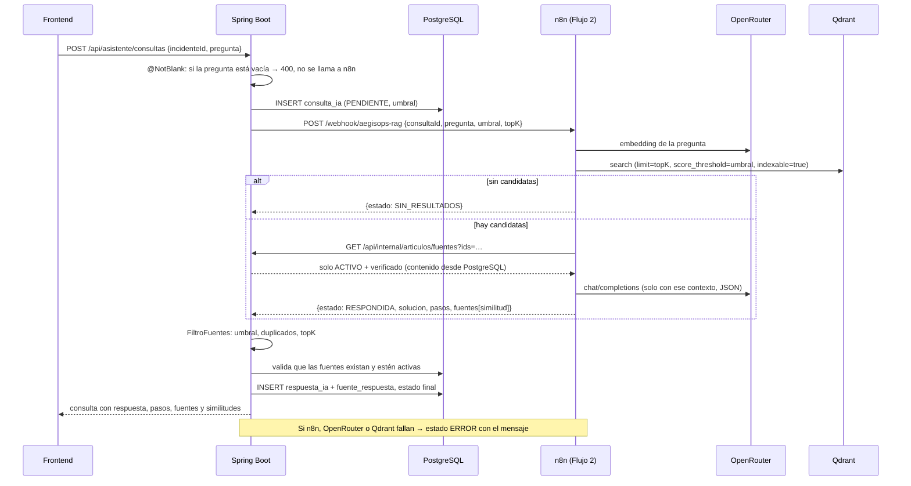

# Arquitectura — AegisOPS

## Componentes



**Regla de negocio 11:** el frontend solo habla con Spring Boot. n8n, Qdrant y OpenRouter quedan detrás del backend. Las claves viven en variables de entorno (`.env`) y en las credenciales de n8n, nunca en el código.

## Capas del backend

```
com.aegisops.backend
├── config      AegisProperties (variables de entorno), CORS, OpenAPI, filtro X-Internal-Token
├── domain      Entidades JPA y enums (Usuario, Categoria, Incidente, ArticuloConocimiento,
│               ConsultaIA, RespuestaIA, FuenteRespuesta, Calificacion)
├── repository  Repositorios JPA + AnaliticaRepository (SQL nativo verificable)
├── service     Reglas de negocio, N8nClient (único cliente hacia n8n), FiltroFuentes
├── dto         Records de entrada/salida y contrato con n8n
├── web         Controladores REST
└── exception   Errores RFC 9457 (ProblemDetail)
```

## Flujo 1 — Indexación de la base de conocimiento (RF03)



Además, al crear, editar, activar o desactivar un artículo, el backend dispara el Flujo 1 solo para ese artículo después de confirmar la transacción. Lo hace en modo de mejor esfuerzo: si n8n no responde, el artículo igual queda excluido como fuente, porque el RAG valida contra PostgreSQL.

## Flujo 2 — Asistencia RAG (RF04, RF05, RF08)



Estados de la consulta: `PENDIENTE` → `RESPONDIDA` | `SIN_RESULTADOS` | `ERROR`.

## Despliegue (Docker Compose)

| Servicio | Imagen | Puerto host |
|---|---|---|
| postgres | postgres:17-alpine | 5433 |
| qdrant | qdrant/qdrant:v1.15.4 | 6333 / 6334 |
| backend | build `./Backend` (Temurin 21) | 8080 |
| frontend | nginx:1.27-alpine | 8081 |
| n8n (perfil `n8n`) | n8nio/n8n | 5678 |
