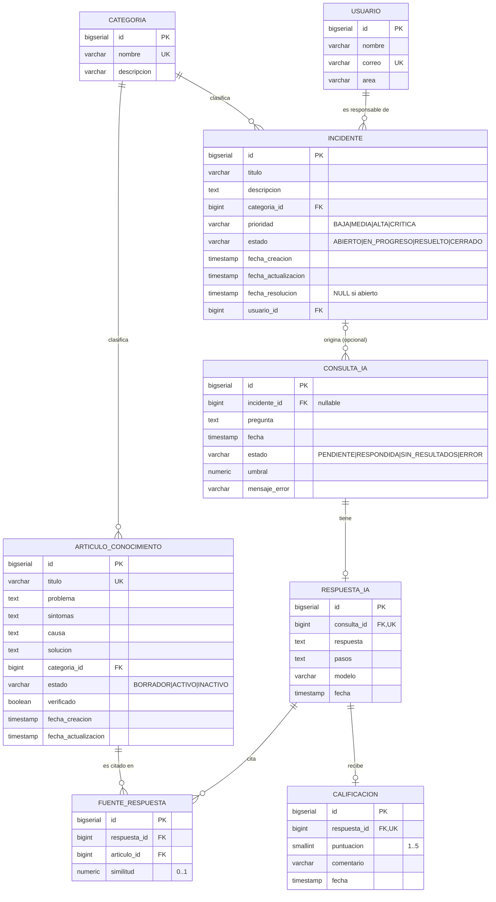

# Modelo entidad-relación — AegisOPS

El script completo, con restricciones e índices, está en `database/01_schema.sql`. Hibernate solo valida el esquema (`ddl-auto: validate`).

## Restricciones de integridad

| Tabla | Restricción | Regla |
|---|---|---|
| usuario | `uk_usuario_correo`, `ck_usuario_correo` | Correo único y con formato básico |
| incidente | `ck_incidente_prioridad`, `ck_incidente_estado` | Dominios cerrados |
| incidente | `ck_incidente_resolucion` | Resuelto/cerrado ⇒ `fecha_resolucion ≥ fecha_creacion`; abierto ⇒ `fecha_resolucion` nula |
| incidente | `ck_incidente_titulo`, `ck_incidente_desc` | Sin textos vacíos |
| articulo_conocimiento | `ck_articulo_estado`, `uk_articulo_titulo` | Estado válido, título único |
| consulta_ia | `ck_consulta_pregunta` | La pregunta no puede estar vacía |
| consulta_ia | `ck_consulta_estado`, `ck_consulta_umbral` | Estados del enunciado; umbral entre 0 y 1 |
| respuesta_ia | `uk_respuesta_consulta` | Una respuesta por consulta |
| fuente_respuesta | `uk_fuente`, `ck_fuente_similitud` | Un artículo no se repite en la misma respuesta; similitud entre 0 y 1 |
| calificacion | `uk_calificacion_respuesta`, `ck_calificacion_puntuacion` | Una calificación por respuesta, de 1 a 5 |

**Borrado en cascada:** al borrar una consulta se borran su respuesta, sus fuentes y su calificación. Al borrar un incidente, sus consultas quedan con `incidente_id = NULL`, así que no se pierde el historial.

## Índices

- `incidente`: `categoria_id`, `usuario_id`, `estado`, `prioridad`, `fecha_creacion`. Cubren los filtros de RF01 y las agregaciones del dashboard.
- `articulo_conocimiento`: `categoria_id`, `(estado, verificado)`. Este último sirve para buscar fuentes válidas.
- `consulta_ia`: `incidente_id` (historial por incidente), `fecha`, `estado`.
- `fuente_respuesta`: `articulo_id` (artículos más usados).

## Relaciones JPA

| Entidad | Relación |
|---|---|
| Incidente → Categoria, Usuario | `@ManyToOne(fetch = LAZY, optional = false)` |
| ArticuloConocimiento → Categoria | `@ManyToOne(fetch = LAZY, optional = false)` |
| ConsultaIA → Incidente | `@ManyToOne(fetch = LAZY)` opcional |
| ConsultaIA ↔ RespuestaIA | `@OneToOne` (dueño: RespuestaIA.consulta) |
| RespuestaIA → FuenteRespuesta | `@OneToMany(cascade = ALL, orphanRemoval = true)` |
| FuenteRespuesta → ArticuloConocimiento | `@ManyToOne(fetch = LAZY)` |
| RespuestaIA ↔ Calificacion | `@OneToOne` (dueño: Calificacion.respuesta) |
